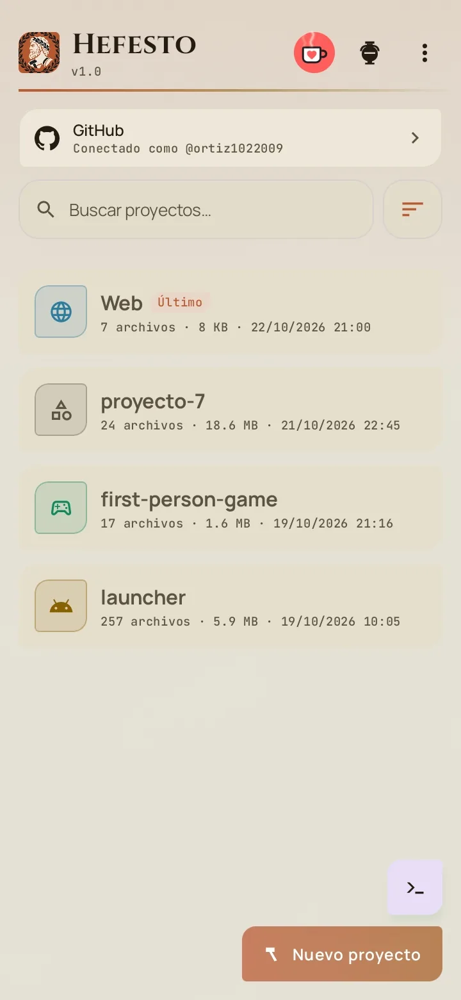
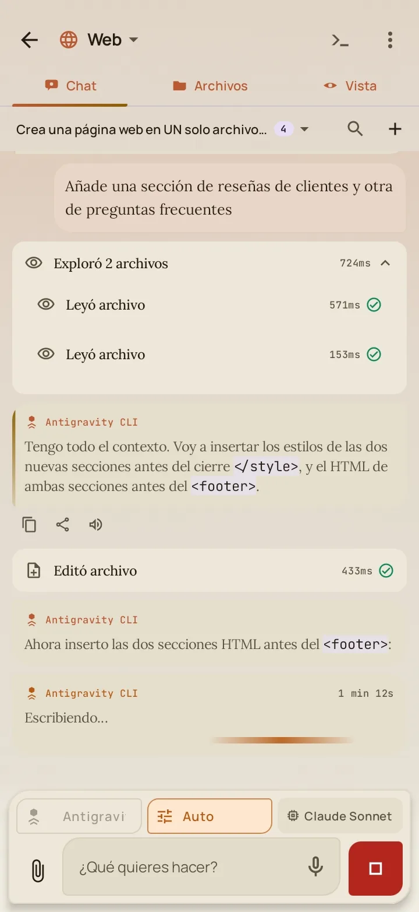
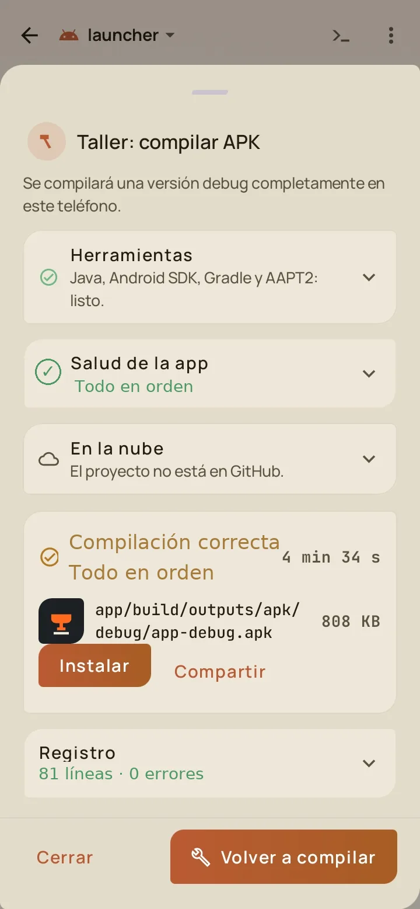
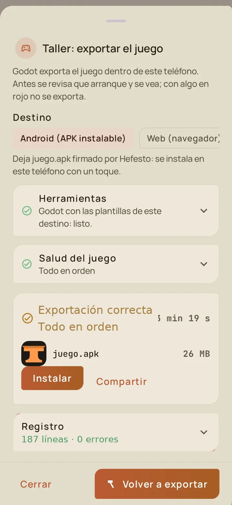

# Hefesto

**Crea aplicaciones, webs y videojuegos desde tu teléfono.** Hefesto lleva un taller de desarrollo
completo dentro de Android: agentes de IA que escriben y corrigen código, un Linux propio y la
compilación de APK — sin PC, gratis y sin anuncios.

**Descargar: [Hefesto v1.0](https://github.com/ortiz1022009/Hefesto/releases/latest)** ·
Android 8.0 o superior · 64 bits · ~67 MB · [Novedades](NOVEDADES.md) ·
[Privacidad](PRIVACIDAD.md) · [Licencia](LICENCIA.md)

**Web oficial:** <https://ortiz1022009.github.io/Hefesto/> — con la guía de instalación paso a paso
y la huella del certificado para verificar el APK.

## Qué hace

- **Agentes que trabajan de verdad.** Pides con tus palabras y el agente crea páginas web,
  aplicaciones Android y videojuegos Godot 4: escribe, ejecuta, corrige y compila — el APK sale del
  teléfono. Varios motores: el agente de Hefesto (con tu clave de OpenAI, Google, Anthropic u
  OpenRouter), Antigravity, OpenCode y **Hefesto local**, un modelo dentro del teléfono que funciona
  sin conexión.
- **Un taller completo.** Ubuntu con terminal de pestañas, apt, Python, Node, Go, Rust y PHP. El
  Ágora instala herramientas con un toque (Godot, Blender, intérpretes) y el agente las usa si las
  necesita.
- **A tu manera.** Revisar, Plan y Auto: tú decides cuánta rienda tiene el agente. Git y GitHub van
  dentro: clonar, ramas, pull requests y publicar tu web en GitHub Pages.
- **El agente mira y corrige.** Ve la vista previa de tu web y de tu juego, y arregla lo que falla.
- **Pensado para el día a día.** Biblioteca de material libre con visor 3D, catorce idiomas,
  apariencia a tu gusto y copias de seguridad cada pocos días — y muchas más mejoras de calidad de
  vida en cada rincón.

## Capturas

| Inicio | El agente | Compila tu APK | Juegos con Godot |
| --- | --- | --- | --- |
|  |  |  |  |

## Instalar

1. Descarga el APK de [la última versión](https://github.com/ortiz1022009/Hefesto/releases/latest).
2. Ábrelo en tu Android (hay que permitir instalar apps de origen desconocido).
3. Opcional: comprueba el SHA-256 con la
   [guía de instalación](https://ortiz1022009.github.io/Hefesto/es/instalar).

**Actualizaciones automáticas:** añade este repositorio a
[Obtainium](https://github.com/ImranR98/Obtainium) (`https://github.com/ortiz1022009/Hefesto`) y te
avisará de cada versión nueva.

## Autor

Hecho por **Diego Ortiz**. Si Hefesto te resulta útil,
[invítame a un café](https://ko-fi.com/ortizdiego2026) ☕

---

### English

**Create apps, websites and video games from your phone.** Hefesto is a full development workshop
inside Android: AI agents that write and fix code, its own Linux environment, and on-device APK
builds — no PC needed. Free, no ads, no account.

**Download: [Hefesto v1.0](https://github.com/ortiz1022009/Hefesto/releases/latest)** ·
Android 8.0+ · 64-bit · ~67 MB · [Release notes](NOVEDADES.md) · [Privacy](PRIVACIDAD.md) ·
[License](LICENCIA.md)

- **Agents that actually work.** Ask in your own words and the agent builds web pages, Android apps
  and Godot 4 games: it writes, runs, fixes and builds — the APK comes out of your phone. Several
  engines: the built-in Hefesto agent (your OpenAI, Google, Anthropic or OpenRouter key),
  Antigravity, OpenCode, and **Hefesto local**, an on-device model that works offline.
- **A real workshop.** Ubuntu with a tabbed terminal, apt, Python, Node, Go, Rust and PHP. The Ágora
  installs tools with one tap (Godot, Blender, interpreters) and the agent uses them as needed.
- **Your call.** Review, Plan or Auto: you decide how much leash the agent gets. Git and GitHub are
  built in: clone, branches, pull requests, and publishing your site to GitHub Pages.
- **It sees and fixes.** The agent looks at your web preview and your game, and repairs what breaks.
- **Made for daily use.** A free-asset library with a 3D viewer, fourteen languages, your own theme,
  periodic backups — and many more quality-of-life improvements all over the app.

Official website: <https://ortiz1022009.github.io/Hefesto/en/> — step-by-step install guide and the
certificate fingerprint to verify the APK.

By **Diego Ortiz**. If Hefesto is useful to you, [buy me a coffee](https://ko-fi.com/ortizdiego2026) ☕
